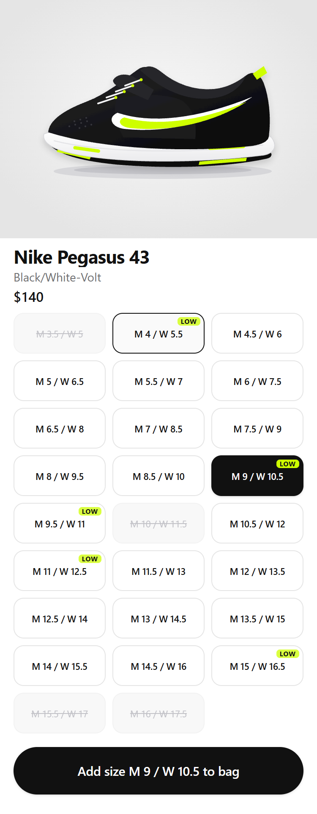

# Nike Pegasus 43 — Mobile Product Page

Zero-layout-shift mobile shoe page for the **Nike Pegasus 43** (`Black/White-Volt`, `$140`) built with Next.js (App Router, TypeScript) and Tailwind CSS.

## How to run it

```bash
npm install
npm run dev
```

Then open [http://localhost:3000/pegasus-43](http://localhost:3000/pegasus-43) (opening [http://localhost:3000/](http://localhost:3000/) redirects to `/pegasus-43`).

For a production build:

```bash
npm run build
npm start
```

## How the page is built

Every section on `/pegasus-43` is laid out inside a `max-w-[375px] mx-auto px-4` container with an explicit Tailwind height from the very first paint so nothing above or around the size grid can shift on a slow connection:

1. **Server-rendered critical HTML (`src/app/pegasus-43/page.tsx`)**: The page reads `data/pegasus-sizes.json` on the server, sorts by `display_order`, and renders the full fixed-height skeleton plus all 26 size `<button>` elements and the Add to bag button in the initial HTML response before any JavaScript loads.
2. **System font stack (`src/app/layout.tsx`, `src/app/globals.css`)**: Uses the OS system font stack only (no web fonts), eliminating font-swap layout shifts.
3. **Reserved fixed-height boxes top to bottom**:
   - **Photo (`h-[281px]`, `-mx-4 w-[calc(100%+2rem)]`)**: 375 × 281 px (4:3) container with a `#E5E5E5` studio backdrop and `object-cover` SVG image (`fetchPriority="low"`, `decoding="async"`).
   - **Name, colorway, and price (`h-[88px]`)**: Displays `Nike Pegasus 43`, `Black/White-Volt`, and `$140` read from the first JSON entry with tight Nike editorial typography (`#111111` / `#707072`).
   - **Size buttons (`h-[496px]`)**: Client component `src/components/SizePickerAndBag.tsx` using a `grid-cols-3 grid-rows-9 gap-2` layout (9 rows × 48 px + 8 gaps × 8 px = 496 px). Each button is a `109 × 48 px` `rounded-xl` tile with `active:scale-[0.97]` tactile feedback. Low-stock `"low"` Volt (`#CEFF00`) micro-pills are `position: absolute` so they never alter button dimensions, and sold-out sizes remain in place at full size on a `#F5F5F5` surface with `aria-disabled="true"` and no click handler.
   - **Add to bag (`h-[56px]`)**: Full-pill `rounded-full` button disabled until a size is picked; updates via local state immediately with `"Add size [size_label] to bag"`, and shows a brief Volt (`#CEFF00`) `"Added"` checkmark confirmation without changing size.
   - **Lazy-loaded below-the-fold sections (`src/components/LazyProductDetails.tsx`)**: `ReviewsSection` (`rounded-2xl` `#F5F5F5` cards with `#111111`/`#CEFF00` avatar badges and rating pill) and `TechCopySection` (2×2 `rounded-2xl` `#F5F5F5` spec bento grid with `style_code` pill) are loaded lazily via `next/dynamic` (`ssr: false`), swapping into fixed-height skeleton placeholders (`ReviewsSkeleton` and `TechCopySkeleton`) of the exact same dimensions.

## Assumptions

- **Reviews height**: Chosen as `384 px` (`h-[384px]`, including `pt-6` top padding and border), holding an overall `★ 4.8 (142)` pill header and 3 fixed `96 px` review cards.
- **Tech copy height**: Chosen as `280 px` (`h-[280px]`, including `pt-6` top padding and border), holding a `style_code` pill (`HV7521-001` from JSON) and a 2×2 bento grid of 4 spec cards (Cushioning, Upper, Traction, Profile).
- **Placeholder image**: Generated a local 4:3 vector shoe illustration in `public/pegasus-43.svg` (750 × 562 viewBox) in Black/White-Volt on a radial studio gray backdrop, spanning full 375 px width via `-mx-4 w-[calc(100%+2rem)]` inside the `px-4` page container.
- **Add-to-bag confirmation duration**: Shows `"Added"` with a checkmark icon for `1500 ms` in Nike Volt (`#CEFF00`) with `#111111` ink before returning to `"Add size [size_label] to bag"` (or immediately resetting if another size is tapped).
- **Disabled Add-to-bag label**: Reads `"Add to bag"` while disabled before a size is selected.
- **Sold-out keyboard focus**: Sold-out buttons keep `aria-disabled="true"` with no click handler and use `tabIndex={-1}` so keyboard focus skips unavailable sizes.
- **Dev indicator**: Set `devIndicators: false` in `next.config.ts` so Next.js's floating dev badge does not overlap the bottom-left corner of the 375 px Add to bag button during local preview.

## Results

Verified with `npm run build` (clean TypeScript + production build) and against `npm run dev` in headless Google Chrome at **375 px** width with **Slow 3G network throttling** (`400 kbps`, `2000 ms` RTT) and **4× CPU slowdown** via Chrome DevTools Protocol:

- **Cumulative Layout Shift (CLS)**: **`0`** (`0` layout-shift entries from initial paint through image decode, hydration, lazy Reviews/Tech & Specs load, and scrolling).
- **Redirect**: `http://localhost:3000/` redirects to `http://localhost:3000/pegasus-43`.
- **First HTML response**: All **26** `role="radio"` size buttons and the **Add to bag** button are present in the initial server HTML before JavaScript executes.
- **Size button counts & dimensions**:
  - **26** buttons total: **4** sold out (`M 3.5 / W 5`, `M 10 / W 11.5`, `M 15.5 / W 17`, `M 16 / W 17.5`), **5** low stock (`M 4 / W 5.5`, `M 9 / W 10.5`, `M 9.5 / W 11`, `M 11 / W 12.5`, `M 15 / W 16.5`), **17** in stock.
  - Every button measures **109 × 48 px** (exceeding the 44 × 44 px minimum).
- **Measured section heights**: Photo `375 × 281 px`, Name/Colorway/Price `343 × 88 px`, Size grid `343 × 496 px`, Add to bag `343 × 56 px`, Reviews `343 × 384 px`, Tech & Specs `343 × 280 px`.

### Screenshot (375 px)



## Anything in this brief you couldn't follow

none
